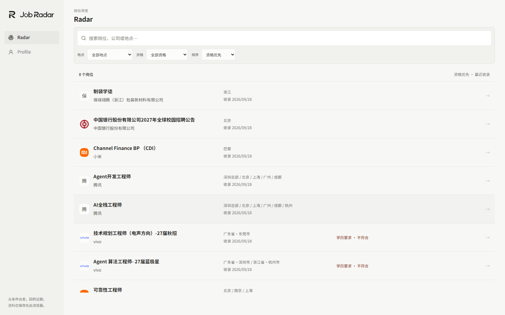

# Company Brand Asset Pack v1 — 2026-10-01

独立 Post-M0 patch；M0 继续 Frozen。没有修改 CSS、尺寸、布局、Profile、资格判断、数据管线、依赖或环境配置。

## 交付与来源

- `src/lib/radar/company-brand.ts`：沿用 canonical company NFKC / 空白 / lowercase 精确身份；只启用三家已核验本地资产，无域名或模糊匹配。
- `public/company-marks/manifest.json`：12 家公司的身份、准入状态、来源、使用说明；实际文件含 SHA-256，开源 SVG 另含 upstream hash、version、commit。
- Xiaomi / vivo：本地 SVG 来自 [Simple Icons 16.33.0](https://github.com/simple-icons/simple-icons/tree/e01988cc57a3aca39621023f9881e9b733ebcd77)，固定 commit `e01988cc57a3aca39621023f9881e9b733ebcd77`。官网身份来源为 https://www.mi.com/global 与 https://www.vivo.com 。仅添加上游品牌色 fill，path 未改变；不依赖字体、位图、CDN、滤镜。
- 中国银行：保留已确认公司身份的 `boc.ico`，不做新 favicon 推导。官方[品牌说明](https://www.boc.cn/english/thisisboc/ab3/brd/202601/t20260104_25638404.html)用于身份复核。未找到可确认 SVG，保留既有图形，不自行描摹。
- 保留 Simple Icons LICENSE / DISCLAIMER 原文。CC0 库许可不等于商标授权，不宣称全面法律许可。

## 当前真实 8 条岗位

| 公司 | 数量 | 结果 |
| --- | ---: | --- |
| 腾讯 | 2 | 腾 fallback；错误子产品 favicon 不恢复 |
| 小米 | 2 | 公司 mi SVG，原品牌橙色 |
| vivo | 2 | 公司 vivo SVG，原品牌蓝色，不是先前 V 形 favicon |
| 中国银行股份有限公司 | 1 | 既有红色公司徽标，ICO 保留 |
| 保禄翊腾（浙江）包装新材料有限公司 | 1 | 保 fallback，无可靠资产 |

只读 preflight：8 jobs / 8 ready / 0 unavailable；没有 ingestion、extraction 或数据库写入。浏览器临时 Guest Profile 为 enrolled / 2027 / bachelor / 机械工程；结果 5 Eligible / 3 Blocked，未为展示改写真实岗位。

## 预留与限制

七家后续品牌只在 manifest 预留，asset=null；没有预下载、runtime mapping、UI 或请求。真实岗位出现后再审核并下载。

- [腾讯官方媒体库](https://www.tencent.com/zh-hk/newsroom/media-resources/)限制媒体报道/编辑用途；尚未确认适用于本项目的许可，继续 fallback。Simple Icons Tencent Hy 不代表母公司。
- [阿里巴巴官方媒体库](https://home.alibabagroup.com/en-US/resource-logos)限制获认可媒体/编辑用途，其他用途需书面许可；不替用 Alibaba.com / Cloud。
- [美团媒体库](https://www.meituan.com/media)有个人/编辑用途限制；不能用开源库许可绕过。
- ByteDance / Baidu：固定库存在公司级 SVG，但本轮没有真实岗位，仅登记后续审核来源。
- Huawei：库有 SVG，但上游官方指南本轮无法读取，暂不准入。
- JD / NetEase：找到官方身份参考，但固定库没有对应公司级 SVG；不以网易云音乐替代网易。

自动审批曾拒绝预下载无真实岗位的预留资产；随后缩小为仅下载当前 Xiaomi/vivo，两者成功。没有通过其他路径下载被拒绝的未来资产。

## 验证与自审

- `npm run lint`：PASS。
- `npm run typecheck`：PASS。
- `npm test`：18 files / 301 tests PASS。
- `npm run build`：PASS，生产构建完成。
- `tests/browser/company_logo_integrity.py`：生产模式真实 8 岗位，5 个本地品牌图像，腾讯 fallback；图片加载失败 fallback；无预留品牌网络请求；Desktop 28/34px、Mobile container 24px 保持；无横向溢出；0 page errors。
- 单测保护未知公司、产品/附属名称、ATS/domain、精确映射、manifest 哈希、SVG 安全结构、未来品牌不启用。
- 浏览器测试初次将 src 错当相对 URL；按实际 Next Image 的绝对本地 URL 修正测试，复跑通过；产品行为未改动。
- 自审确认：只替换小米资产格式、恢复 vivo 公司标识；保留 BOC 和 fallback 样式；旧 xiaomi.ico 无生产引用后移除；manifest 不进入客户端 bundle，无运行时依赖增加。

截图：

Tencent 使用许可与未来资产审核是明确未决项；本次不宣称所有品牌资产齐备。不进入 M1，不部署。
